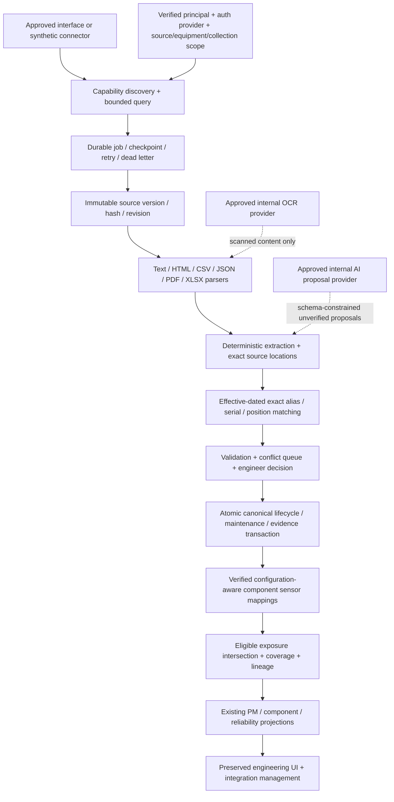

# Phase 2: authorized enterprise integration handoff

FRIP retains the existing React/TypeScript engineering UI, FastAPI API, normalized SQLAlchemy database, calculation services, migrations, and synthetic fleet. Phase 2 extends ingestion, evidence review, identity resolution, component sensor context, and calculation lineage. It does not connect to any actual Samsung or Lam system.

The inspected checkout has a GitHub remote and GitLab-compatible CI. No internal GitLab interface or credentials are configured in this external environment. Treat any transfer or internal GitLab publication as a separate approved action; the presence of `.gitlab-ci.yml` is not evidence of a GitLab deployment.

## Integration architecture



No source capability in this diagram implies that a real service exposes it. Capability contracts return supported/unsupported operations explicitly. A source that cannot search or supply history must use an approved alternative, or leave that workflow unavailable. There is no fallback to restricted scraping or endpoint discovery.

## Repository handoff package

| Artifact | Purpose |
| --- | --- |
| [Initial gap analysis](PHASE2_GAP_ANALYSIS.md) | Baseline implementation and targeted extension plan. |
| [Integration matrix](INTEGRATION_MATRIX.md) | Features, normalized record needs, source access, and unresolved contracts. |
| [Canonical dictionary](DATA_DICTIONARY.md) | Domain, source version, review, job, sensor and lineage semantics. |
| [Sensor mapping guide](SENSOR_MAPPING_GUIDE.md) | Physical relationship and configuration-aware approval. |
| [RF-hour validation](RF_HOUR_VALIDATION.md) | Exposure formulas, uncertainty rules, reference calculations, and acceptance cases. |
| [Security boundaries](SECURITY_AND_DATA_BOUNDARIES.md) | External synthetic mode, confidential internal mode, scopes, secrets, exports and hard stops. |
| [Internal AI instructions](INTERNAL_AI_INSTRUCTIONS.md) | Executable repository inspection, approved schema discovery, implementation and test order. |
| `integration_manifests/*.json` | Six strictly validated unconfigured source templates. |
| `schemas/manifest.schema.json` | Draft 2020-12 JSON Schema for those templates. |
| [Validation ledger](PHASE2_VALIDATION.md) | Current-run evidence; do not infer results from a listed command. |

The manifests use `informs`, `fdc_trace`, and `lam_parts` as handoff names, with legacy adapter bindings `maintenance`, `fdc`, and `parts`. Alarm, commissioning, and generic categories retain their names. Source fields, endpoints, transport, auth providers, permissions and actual capabilities are deliberately null or empty until discovered through approved channels. Required normalized fields describe FRIP destinations, not proprietary schemas.

## Local synthetic operation

```bash
./scripts/setup.sh
./scripts/dev.sh
```

The original fleet uses the fixed 2026-01-31 UTC engineering snapshot. Integration fixtures are fictional and may use separate IDs and dates; do not merge them into the baseline by display-name similarity. Synthetic scenarios must create or resolve their own reviewed aliases and lifecycle records. See the validation ledger for the complete source-to-component-to-PM test evidence.

After setup, run the isolated automatic demonstration from `backend/`:

```bash
../.venv/bin/python -m app.enterprise.demo
```

It drives the production APIs against a temporary SQLite database, preserving the existing application database. A synthetic Informs replacement document produces 14 verified exact evidence spans, an engineer approves the resolved lifecycle change, and a synthetic operating trace proposes two sensor mappings plus one RF exposure rule. Separate engineering approvals make five twelve-hour active periods eligible. The removed serial has 70 RF hours; the replacement has 60 RF hours, complete observation coverage, and 590 hours remaining against a fictional 650-hour policy. Inventory, component details and fleet PM are refreshed through their normal APIs. Calculation lineage identifies retained source versions, rule, mapping, configuration period and observed samples. The temporary database is deleted after the JSON report is printed.

`backend/tests/test_enterprise_acceptance.py` verifies the fixed arithmetic and approval gates automatically. `frontend/e2e/enterprise.spec.ts` covers the corresponding browser workspace and refreshed component page, following the six preserved original workflows. In the UI use **Data integrations → Enterprise handoff workspace** and the component drawer's **Telemetry & lineage** tab. Local role bindings must be configured on the server; a browser role/header is never authoritative.

## Operational interfaces

All integration routes use `/api/enterprise`; consult the running OpenAPI for exact bodies, status codes and dependencies.

| Interface | Function |
| --- | --- |
| `sources` and `sources/{id}/capabilities` | Authorized source status, explicit supported/unsupported operations and source-neutral schema discovery. |
| `jobs`, `jobs/{id}/run`, `jobs/{id}/retry` | Submit bounded backfill/incremental/reprocess work, execute a worker pass, and retry authorized failed work. |
| `dead-letters` and `dead-letters/{id}/retry` | Inspect isolated failures and request a targeted reprocessing job. |
| `documents`, `documents/{id}` | Original-version and parsed evidence, within source/equipment/collection grants. |
| `sources/{id}/mapping-preview` | Read-only field-mapping/extraction preview for an authorized preserved source version; creates no claims or canonical records. |
| `proposals`, `proposals/{id}/preview`, `proposals/{id}/review` | Inspect matching/validation, then approve/reject/correct with an engineering audit decision. |
| `aliases` | Reviewed effective-dated exact identity associations. |
| `sensors`, `mappings`, `exposure-rules` and review routes | Catalog, propose and separately approve physical relationships and exposure definitions. |
| `components/{id}/telemetry`, `components/{id}/lineage` | Bounded applicable diagnostic traces and reproducible exposure derivation. |
| `sources/{id}/schedule` | Administrator-authorized, bounded, opt-in synchronization scheduling. |

For a local **synthetic** worker pass after setup, from `backend/`:

```bash
../.venv/bin/python -m app.enterprise.worker --once --limit 10
```

This is a one-pass worker, not a resident scheduler. Periodic invocation belongs to the approved deployment scheduler. Polling remains opt-in and capability/access controlled. The CLI rejects enterprise mode until an approved scoped service identity is installed; there is no implicit production administrator worker. Production hosting, source SLA, monitoring and schedule approval remain deployment responsibilities.

## What authorized engineers must supply

For **c-TTTM / Informs**, supply the approved structured-record and document/attachment interface, capability support, schema or managed-export layout, work-order identifiers, revision/correction behavior, search scopes, equipment/collection access grants, timestamps, actual replacement/PM completion semantics, retention, and OCR/internal-AI authorization.

For **FDC Trace**, supply channel catalogs and meanings, actual units, source/RF generator identity, measured versus state/counter classification, operating-mode normalization, sampling cadence, clock uncertainty, valid ranges with controlled references, observation coverage, reset/rollover semantics, bounded retrieval contract, rate limits, watermark and retention.

For **Lam UI parts**, supply approved current/historical inventory access, exact configuration/position catalogs, physical versus planned state, part/serial/revision identity semantics, install/remove effective time, refurbishment qualification, alternate parts, correction/version behavior, and field-level authority relative to maintenance records.

For all sources, supply a named owner, approved interface documentation, service identity and least privilege, secret-provider references, equipment and collection allowlists, query/load approvals, audit/retention policy, data classification, and tested failure/retry behavior. Never supply credentials in chat, source code, manifests, or frontend variables.

## Promotion and review rules

Source documents remain originals. Parsed text and extracted claims retain document hash/revision and exact page, row, block or span locations where available. Extraction confidence describes interpretation certainty; it is not human verification or evidence that hardware failed. AI and OCR are provider interfaces, with no external corporate-data provider enabled.

Canonical installation/replacement requires resolved physical identities and aware effective timestamps, documented compatibility, no overlapping component/slot occupancy, adequate source evidence, authorized engineer review and an atomic audited transaction. Missing serial/time, conflicting assertions or uncertain diagnoses enter review rather than authoritative inventory. Rejection and correction preserve history. Resolving a source conflict does not silently rewrite its originals.

Verified sensor mappings and exposure definitions carry their own approval and applicability. A part replacement or alarm does not establish a hardware failure. PM policies, OEM requirements, statistical estimates and diagnostic telemetry remain separate classifications. No automatic equipment intervention or source-system writeback is implemented.

## Recommended completion order

1. Transfer the code internally through approved GitLab procedures; establish SSO, service authentication, secrets, data classification and exact source/equipment/collection permissions.
2. Inspect the manifests and contracts, discover supported capabilities and schemas through the approved interface, and record unknowns rather than inferring internal fields.
3. Implement Informs document/record retrieval and Lam inventory history together. Validate deterministic entity matching, source authority, review and atomic replacement against known historical examples.
4. Validate the actual sensor catalog and configuration-aware component relationships with equipment engineers. Approve RF-active/source/counter definitions before ingesting operating history into exposure.
5. Run bounded backfill and incremental synchronization with checkpoints, duplicates, revisions, faults and permission denials. Confirm approved canonical results match historical physical truth.
6. Associate alarms, maintenance findings and FDC evidence with adjudicated failure episodes and unioned downtime. Add commissioning critical-path evidence separately.
7. Run the A–I acceptance suite inside the approved environment, then a read-only shadow period with reconciliation and meter comparisons. Production data promotion, exports and advisory forecasts require separate engineering/security approval.

No test with fictional data demonstrates live connectivity, OEM accuracy, actual precursor validity, production reliability rates, or permission to poll an internal source.
