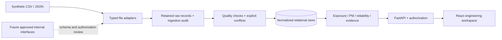

# Architecture and operating assumptions

## Boundaries

FRIP separates presentation, API authorization, normalized storage, ingestion, and engineering calculation. The React/TypeScript client requests backend projections; it does not calculate an independent source of engineering truth. FastAPI publishes OpenAPI, validates inputs, and enforces permissions. SQLAlchemy targets PostgreSQL or local SQLite; Alembic versions schema changes. Calculation services accept typed engineering inputs and can be tested without the UI or proprietary systems.

No adapter discovers internal endpoints, scrapes screens, or controls hardware. The six adapter categories describe potential source responsibilities, not a statement that a real internal system supports a specific API.

## Data flow

1. A source record is identified by adapter, source ID, timestamps, and canonical content fingerprint. Retain the original before deriving normalized values.
2. Validate source scope, typed fields, units, timezone offsets, and incremental cursor. Duplicates are reported rather than silently multiplied.
3. Conflicting source assertions remain separate. Explicit priority rules or a human audit decision determine reconciliation; arrival order is not authority.
4. Effective-dated installation records join serialized parts to physical positions. Interval ends are exclusive. Active-position and active-component uniqueness prevents two current occupants; lifecycle services also reject historical overlaps.
5. Exposure is clipped to the selected installation window and eligible chamber, source, and dimension. Removed parts stop accumulating exposure at removal. Qualified refurbishment creates a separate exposure boundary; lifetime history is retained.
6. PM policies consume only matching dimensions and preserve their documented basis. Coverage is displayed with the result. Synthetic engineer recommendations are distinct from OEM requirements.
7. Failure and downtime projections use adjudicated episodes and interval unions. Multiple symptoms can refer to one episode; neither a symptom nor replacement is proof of failure.

Legacy file import is a **staging workflow**: it stores validated raw records, original attempts, ingestion results, and conflicts. The Phase 2 enterprise workflow adds immutable source versions, exact-location extraction, effective aliases, engineering review, canonical transactions, sensor/exposure applicability and durable job lineage. Arrival alone never promotes a field into physical truth. File-fixture equipment IDs and timestamps are intentionally separate from the seeded fleet. Actual source mapping, field authority and access must be approved before real-source ingestion changes canonical records. See the current [integration architecture and handoff](SAMSUNG_HANDOFF.md).

The demo snapshot is fixed at 2026-01-31 UTC. A repeatable snapshot avoids accidental PM changes caused solely by when the application is launched. Production operation must introduce an approved clock, freshness SLAs, event-time watermarking, and operational scheduling.

## Storage strategy

The relational model contains equipment hierarchy, component definitions and instances, source provenance, installation history, exposure intervals and counters, plans and maintenance actions, failure evidence, equipment events, trace points, downtime attribution, reconciliation, and audit records. See the [data dictionary](data-dictionary.md).

SQLite is for single-developer standalone demonstration. PostgreSQL is the preferred shared deployment target. API-level overlap checks supplement current-occupancy indexes; a production concurrency review should add appropriate PostgreSQL exclusion constraints or serialized transaction controls for historical interval writes. Do not assume local SQLite concurrency represents fab-scale behavior.

FDC points are ordinary relational rows for the small fixture. Large trace storage is not implemented as TimescaleDB in this foundation. Before scaling, define retention, partitioning, compression, downsampling, lineage, approved object storage, and query access boundaries. Preserve immutable originals even when analytical projections are regenerated.

## Runtime and deployment

Local scripts create a repository `.venv` and run migrations and idempotent seeding before startup. The initial migration contains frozen explicit DDL for 35 normalized tables; it does not import live application metadata. Future model changes require a new reviewed revision. The dev frontend proxies `/api`; Compose uses nginx for the built frontend and a private PostgreSQL service. The API and UI bind locally in Compose. No credentials or internal network are needed for the default synthetic mode.

Configuration is environment-based. Dependencies are locked, Python artifacts are hash verified, and npm uses its lockfile. Structured API logs and database ingestion/audit rows form the initial observability surface. Distributed tracing, metrics aggregation, backup/restore automation, high availability, deployment approvals, and corporate secret-manager wiring remain deployment work.

## Extension points

- Adapters translate approved external records into typed, source-tagged input; they do not encode authority by arrival order.
- An authentication provider must produce verified principals; domain authorization remains server-side.
- Calculation services can be extended with additional exposure dimensions, provided physical applicability and source units are documented.
- Forecast providers must return eligibility, state, limitations, and version traceability rather than arbitrary health scores.
- Equipment hierarchy is configuration-driven. The tree is a conceptual inventory structure, not an OEM-accurate chamber drawing.
